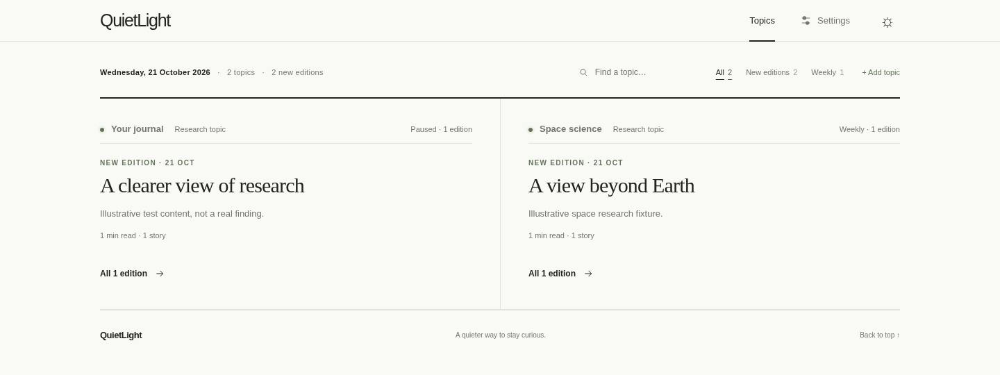

# QuietLight

**Your research, thoughtfully gathered.**

A self-hosted research journal powered by [Hermes](https://github.com/NousResearch/hermes-agent).
Describe what you care about. QuietLight turns it into research briefings with
original sources, clear explanations, and diagrams worth slowing down for.

Minimal by design. Made for desktop and mobile. Yours to keep.

<picture>
  <source media="(prefers-color-scheme: dark)" srcset="docs/images/quietlight-dark.png">
  
</picture>

*The application with illustrative sample content—not real research or personal data.*

## A quieter way to stay curious

- **On your schedule.** Follow each topic daily, on weekdays, or weekly—or generate
  an edition on demand. Read the latest revision for each publication day. Earlier
  revisions are retained in SQLite; browsing them in the journal is not yet supported.
- **Your direction.** Set the research brief, topics, sources, cadence, and publishing time.
- **Light or dark.** Follow your device's appearance, or use the theme control in
  the top bar to cycle through system, light, and dark. Your choice stays in this browser.
- **Context, not just links.** Understand what changed, why it matters, and what remains uncertain.
- **A closer look.** Maximize diagrams and local or embedded images, zoom in,
  and scroll to explore the details. Close with Escape or the close button.
- **A little memory.** A local coverage ledger helps the researcher avoid repeating itself.
- **Follow the evidence.** Minimal numbered citations open a folded source list.
  Copy individual references or the full bibliography to share original material.
  New editions cite specific claims; older editions retain their original links.
- **Research as it happens.** Open a topic to see searches, linked sources being read,
  reading failures, and writing activity. The page checks for updates every five seconds
  and shows the new edition automatically. Activity is reported by the research agent;
  a quiet feed does not necessarily mean the run has stopped. After upgrading, rebuild
  the journal and restart the worker when idle to apply the updated research prompt.

## Start here

You need Docker with Compose, Bash, and a supported hosted model account.
The pinned Hermes image currently targets **Linux x86-64**. No Ollama required.

```bash
git clone https://github.com/itsjrsa/quietlight.git
cd quietlight
./quietlight.sh prepare
./quietlight.sh setup
./quietlight.sh start
```

Complete Hermes' model and web-tool configuration during setup. The example
configuration starts with its Codex provider; other providers need a compatible
search backend too. Account access and usage limits depend on your provider.

Your first installation includes a general science-and-technology brief: up to
six stories, a three-day lookback, primary sources, and plain-language explanations.
Automatic research starts paused. Existing profiles are never replaced by setup.

Personalize it in a terminal conversation with Hermes:

```bash
./quietlight.sh personalize
```

Tell it what you care about and how you will use the research. It proposes settings
and applies them after you agree—no web settings or access-key copying needed.
Model access must be configured first; this conversation uses your provider.
You can rerun the same command later to refine your brief.

Then try an edition and read it at **[localhost:8097](http://localhost:8097)**:

```bash
./quietlight.sh generate
# After reviewing your first edition, enable automatic research if you want it:
./quietlight.sh schedule 08:00
# Pause any time:
./quietlight.sh schedule off
```

Choose daily, weekdays, or weekly in Settings → **Research cadence**. A fresh
install defaults to daily; `schedule HH:MM` retains the cadence you have selected.

Wait for the worker to become ready after startup before generating. Times use
**Europe/London**, including daylight saving. Research uses provider quota and
may incur charges. Settings in the website remain available for occasional edits.

Prefer another LLM? Copy the prompt and JSON template in
[Personalize your journal](docs/personalization.md), then apply its output with
`./quietlight.sh configure data/research/settings.draft.json`.

## Follow several topics

In Settings, use **Add topic** to give another interest its own research brief,
sources, and archive. New topics start paused: refine the brief, enable **Research
automatically**, and save. **Generate now** researches only the selected topic,
including when it is paused.

The homepage is a broadsheet: each topic is a section showing its latest
edition and the few before it, under a dateline masthead with search and filters.
Filter for new editions or weekly topics, then open a section to read that
topic's briefings. New-edition markers track reading on the current browser;
they are not synced across devices.
Each topic has its own reading page and coverage memory. Existing editions and links remain available under
the first topic, **Your journal**, which you can rename.

Each topic has its own **Research cadence**: daily, weekdays, or weekly. Choose a
time in London and, for weekly research, a day. **Research automatically** controls
that topic alone. Set **Look back** to cover the time between editions—for example,
seven days for a weekly topic. Existing schedules carry over until you edit them.
Each active topic runs its own research job, so adding topics increases provider
usage. Pause topics without removing their editions. Up to 20 topics are supported.
Terminal personalization, configuration, generation, and scheduling target the
original topic; `schedule HH:MM` changes its time while retaining its cadence.

## Private by default

The journal binds to localhost. Reading needs no login; settings and research
requests require your access key. Use a trusted private network for remote access,
not a public port or tunnel. See [running QuietLight](docs/running.md) for Tailscale,
backups, and troubleshooting.

The archive stays on your machine, but research uses external services. Your
research brief and relevant context are sent to the configured hosted model;
search queries and requested source URLs go to your search and extraction
providers. Their data-handling policies apply. Avoid including confidential
information unless those services are approved for it. The reading interface
loads its scripts locally and includes no analytics.

Research is generated by an agent: follow the sources and check important claims.
Search budgets are guidance, not billing caps. Telegram and WhatsApp notifications
are not implemented yet.

## Under the surface

Hermes researches. A small Python service keeps the archive and serves the journal.
Plain JavaScript, CSS, and Mermaid handle reading and diagrams. No database service,
frontend framework, or fork of Hermes.

[Architecture](docs/architecture.md) · [Contributing](CONTRIBUTING.md) · [Security](SECURITY.md)

## Roadmap

The next steps are about making research easier to follow, find, and manage.
These features are planned or under consideration; priorities may change.

- [ ] **Telegram notifications.** Get a message when an edition is published,
  with a link to read it. Retry failed notifications without repeating research.
- [ ] **Your timezone.** Choose a timezone for scheduling and edition dates,
  rather than relying on Europe/London.
- [ ] **Search the archive.** Find past stories and sources across topics, with
  filters for topic and date.
- [ ] **Bookmarks and reading lists.** Save useful stories and sources to return
  to later.
- [ ] **Clearer run diagnostics.** Understand why a run failed, see provider
  usage where available, and choose when to retry.

Have another idea? [Open an issue](https://github.com/itsjrsa/quietlight/issues)
and describe how it would help your research routine.

## License

[MIT](LICENSE). Hermes and third-party dependencies retain their own licenses.
