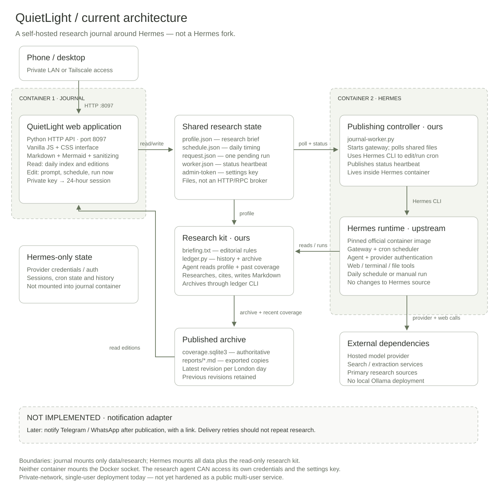

# How QuietLight fits together

QuietLight is a small application around **unmodified upstream Hermes**, not an
agent framework or a Hermes fork. Two containers share a research directory.

## The research side

`research/journal-worker.py` starts the Hermes gateway and manages a cron job per
topic (`morning-research` for the original topic and `morning-research-<id>` for
new topics). It applies each topic's schedule and pause setting, reports a heartbeat, and
consumes manual requests from a single-file queue. It refuses to dispatch when
the execution database cannot be read. A manual run is only reported as complete
after the requested topic's archive gains an edition. A manual request identifies
one topic; active research in any topic blocks a new manual dispatch. Scheduled
jobs have independent daily, weekday, or weekly schedules; Hermes controls their
execution concurrency. Times use Europe/London and its daylight-saving rules.

Hermes handles model access, web tools, job execution, and execution history.
`research/briefing.txt` supplies the editorial instructions. The worker scopes all
profile, draft, and ledger paths in each job's prompt to that topic. The agent reads your
profile, checks previous coverage, researches, and invokes `research/ledger.py`.

The ledger validates source URLs and identifiers, then stores Markdown and source
metadata in SQLite. A content hash makes identical submissions idempotent. DOI,
arXiv, and normalized URL identities help track coverage; recognizing related
work still depends on the researcher. Markdown files are convenience exports:
**SQLite is the authoritative archive**. The original topic continues using
`data/research/profile.json` and `coverage.sqlite3` without moving existing data.
New topics use `data/research/topics/<id>/` with independent profiles, coverage
databases, drafts, and exports. `data/research/journal/topics.json` stores stable
identifiers, display names, follow switches, and per-topic schedules. Schedules
contain `enabled`, `time`, `cadence` (`daily`, `weekdays`, or `weekly`), and `weekday`
(0 for Sunday through 6 for Saturday). Topics without a saved schedule inherit
the old `journal/schedule.json` as a frozen fallback. Editing one topic never
changes that file or another topic's schedule. An absent catalog means the
original topic only. New topics start paused. Pausing retains all history.

## The reading side

`journal/server.py` serves the static frontend and a small JSON API using Python's
standard library. It reads the archive and writes preferences, schedule, and
generation requests. It cannot call Docker or access the provider credential
directory. The latest revision for each London calendar day appears in the index.

`journal/web/app.js` contains the topic index, topic journal, edition, and settings
routes. `/topics/<id>` and `/topics/<id>/edition/<date>` identify topic archives;
legacy `/edition/<date>` links still open the original journal. The settings,
editions, and generate APIs accept `?topic=<id>` and default to the original topic.
Unknown identifiers are rejected. Topic creation and settings changes require
the existing authenticated session. Research briefs remain behind authentication.
The build bundles dependencies locally. Markdown is sanitized with DOMPurify;
Mermaid runs in strict mode and its SVG is sanitized again. The page loads no
remote fonts, analytics, or CDN scripts.

## State and boundaries

| Location | Purpose | In Git? |
| --- | --- | --- |
| `journal/` | Web service, frontend, tests | Yes |
| `research/` | Worker, archive helper, research instructions | Yes |
| `data/` | Hermes configuration, credentials, sessions, cron history | Never |
| `data/research/` | Private profile, archive, request queue, settings key | Never |

The agent can read its own provider credentials and the shared settings key.
The key protects network edits, **not** against a compromised agent. Outbound
network access is necessary for research and is not restricted to an allowlist.
See [the security model](../SECURITY.md).

## Deliberate limits

This is a single-user, private-network application. Sessions are in memory and
expire after 24 hours; restarting the journal signs you out. The queue has one
slot. An interrupted request is not automatically regenerated because that could
repeat paid research. Scheduling and edition dates currently use Europe/London.

Notifications are a future integration. Delivery should happen after archival,
with independent retries so a failed message never triggers another research run.
